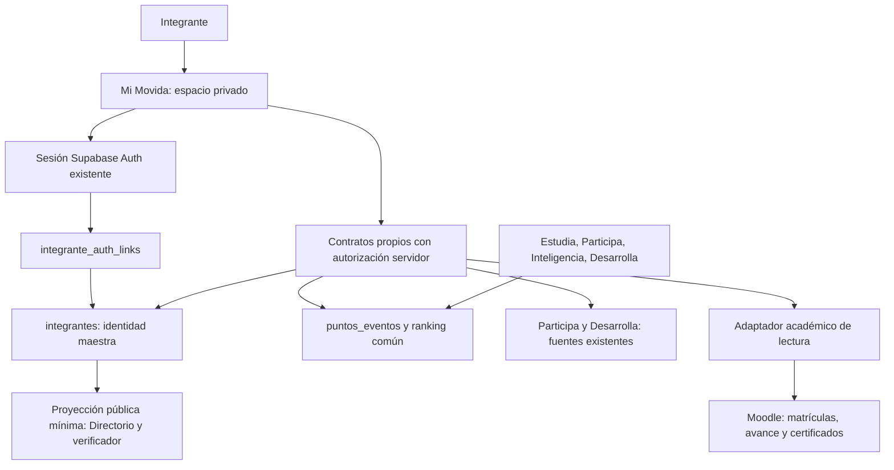

# Mi Movida — Auditoría integral del perfil
Fecha: 1 de noviembre de 2026 · Estado: propuesta para revisión; sin implementación.

## Decisión recomendada
Mi Movida debe ser el espacio privado del integrante sobre la identidad y los servicios existentes. Conservar `integrantes` como registro maestro, `puntos_eventos` como libro de XP y Moodle como autoridad académica. Integrar primero identidad, recuperación, perfil, credencial y consulta de actividad. Mantener las aplicaciones de participación, aprendizaje, gestión y herramientas especializadas funcionando en sus dominios.

No crear otro padrón de personas, otra contraseña del participante, otro acumulador de XP ni otro emisor de certificados. Una interfaz nueva sí requiere contratos de lectura propios y una sesión verificable; reutilizar funciones no equivale a copiar indiscriminadamente sus respuestas o sus permisos.

## Alcance y evidencia
Se inventariaron los **83 repositorios accesibles de movidasst**, sus árboles de la rama principal y entradas de aplicación disponibles; se profundizó en autenticación, perfil, XP, Participa, Inteligencia, Desarrolla, Moodle, Drive y herramientas con identidad. El inventario anexo identifica cada repositorio, árbol y archivos revisados. Dos repositorios devolvieron repositorio vacío. La carpeta local inicialmente solo contenía `.git`, sin remoto ni implementación de Mi Movida.

Se consultó en modo lectura la base Supabase **Directorio-movidasst-plus**, proyecto `lfdmbkzghnwvsapxypvt`: columnas, índices, políticas RLS, definiciones de funciones seleccionadas, funciones Edge desplegadas y conteos agregados. Se inspeccionó también el código desplegado de `crear-sesion-integrante`, `validar-integrante`, `moodle-link-reconcile`, `moodle-admin` y `academia-resenas`. No se ejecutaron logins, recuperaciones, envíos de correo, importaciones, asignaciones de XP ni escrituras de negocio.

**Límites:** inventario y auditoría de las rutas relevantes, no revisión exhaustiva de cada línea o pentest. No se accedió a sesiones reales de participantes, archivos de WhatsApp, registros individuales, configuración interna de Moodle, Apps Script, Sheets ni blockchain/Render en ejecución. Un enlace Moodle guardado no demuestra que la cuenta exista, esté habilitada o corresponda a la persona correcta. La existencia de una función Edge no prueba su disponibilidad extremo a extremo. Las pruebas funcionales quedan especificadas para un entorno de prueba.

### Hechos comprobados en la base
| Comprobación agregada | Resultado |
|---|---:|
| Integrantes | 2.076 |
| Sin public_id | 0 |
| Con moodle_user_id | 2.076 |
| Vínculos en integrante_auth_links | 1 |
| Grupos de correo normalizado compartido por más de un integrante | 1 |
| Clasificados comparados entre fórmula personal y pública | 234 |
| Posiciones distintas en esa comparación | 234 |
| Eventos de Inteligencia con metadata.fuente=inteligencia_grupo | 234 |
| XP confirmados de esos eventos | 13.050 |

Estas cifras son una fotografía de lectura, no un compromiso de que no cambien. No se extrajeron correos, documentos, claves, tokens ni nombres de participantes para este informe.

## Hallazgos que condicionan el proyecto
**H1 · P0 · Identidad internacional incoherente.** Registro y Directorio usan país + documento, pero Estudia exige cédula numérica y código de cinco caracteres. Participa acepta documento alfanumérico sin país; Drive y varias herramientas reducen a dígitos. Las Edge `crear-sesion-integrante` y `validar-integrante` también eliminan letras del documento. Una misma persona puede quedar sin acceso o una normalización puede colisionar. No migrar estos supuestos a Mi Movida.

**H2 · P0 · Unicidad comunicada y efectiva no coinciden.** `integrantes_documento_uidx` impone unicidad global de upper(trim(documento)), sin país ni tipo. `registrar_integrante_internacional` informa un duplicado “en el país seleccionado”. Esto bloquea documentos iguales de países distintos. Cambiar la restricción exige acordar país emisor frente a país de residencia: el editor permite cambiar `pais_iso2`, por lo que ese campo no debe convertirse automáticamente en país emisor. La deduplicación de una persona con varios documentos requiere revisión y trazabilidad, no una fusión por nombre/correo.

**H3 · P0 · Sesión y autorización fragmentadas.** Hay credencial documento/código, tokens de Participa, tokens de Drive, sesiones MAC/PP, accesos visuales locales y Supabase Auth. `integrante_auth_links` ya tiene índices únicos en ambos sentidos y política de lectura propia, pero solo una fila. La Edge de sesión genera/reutiliza Auth con correo técnico y datos en user_metadata; en su código no aparece escritura a `integrante_auth_links`. Verificar triggers antes de atribuirle una vinculación automática. Reutilizar el mecanismo después de endurecerlo y completar su vínculo, no crear otra base de usuarios.

**H4 · P0 · Autorización PIF depende de metadatos editables.** La definición desplegada de `pif_current_integrante_id()` lee `auth.jwt()->'user_metadata'->>'integrante_id'`; `pif_ensure_access`, `pif_has_full_access` y políticas dependen de ello. Es un riesgo concreto de confusión de identidad y privilegios. Resolver la identidad desde el vínculo de servidor existente. No se intentó suplantación ni modificación de metadatos. Bloquea la integración privada de PIF y el uso de ese patrón como estándar común.

**H5 · P0 · Ranking inconsistente.** `ranking_publico` excluye IDs 1/575 y exclusiones activas antes de ordenar. `estudia_mi_progreso` calcula posiciones sobre todos los totales y después oculta solo al consultante excluido. `directorio_publico_actividad` tampoco aplica esas exclusiones; su v2 conserva este problema. La comparación agregada de fórmulas arrojó 234 diferencias para 234 clasificados. El orden actual usa puntos descendentes + integrante_id ascendente: personas con igual XP reciben posiciones distintas. Conservar ese desempate en la migración; cualquier cambio de regla necesita una decisión separada.

**H6 · P0 · Privacidad y minimización insuficientes para ampliar el portal.** Las RPC públicas del Directorio devuelven correo, edad y género; el verificador devuelve documento completo. Hay preferencias para WhatsApp, pero no se encontró una preferencia equivalente de correo en `integrantes`. El consentimiento general del registro no debe interpretarse automáticamente como autorización para publicar cada dato o un historial privado. `acceso_integrante_internacional` devuelve to_jsonb(i) menos código: incluye columnas internas de sincronización. Mi Movida necesita una lista explícita de campos, no ese registro completo.

**H7 · P0 · Recuperación antigua y código corto.** El Directorio usa Apps Script para recuperar código por cédula numérica de 6–12 dígitos; no envía país. Su mensaje evita confirmar existencia y distingue Moodle, lo cual se debe conservar. No se pudo verificar el backend, su límite de intentos ni su entrega. El registro genera cinco caracteres hexadecimales: ~20 bits, insuficientes como único secreto permanente sin controles robustos. En las RPC de acceso internacional y progreso inspeccionadas no se observó limitación de intentos. Verificar controles externos antes de concluir exposición explotable.

**H8 · P1 · No sumar dos veces las fuentes.** Inteligencia ya escribe en `puntos_eventos` como actividad, fuente inteligencia_grupo y sin sesion_id; hay índice único por referencia del grupo/mes/integrante. Desarrolla también puede producir XP: no asumir que solo existen Estudia, Participa e Inteligencia. El historial personal actual limita a 120 movimientos y no devuelve `metadata.fuente`; por ello un desglose por fuente reconstruido desde él puede ser incompleto o ambiguo.

**H9 · P1 · Credencial heredada mezcla secreto y verificación.** `miembros/index.html` envía cédula/código en query string a Apps Script y construye un QR con `data.codigo`. No copiar ese flujo; revisar si ese campo coincide con el secreto de acceso. El Directorio actual ya dispone de `public_id` y verificador internacional. Mantener verificaciones antiguas con una transición controlada, sin propagar códigos privados en enlaces, terceros de QR, analítica o logs.

**H10 · P1 · Avance no equivale a certificado emitido.** Gestión consulta cursos y finalización Moodle, pero el campo `certificate_status` observado se deriva de completado y dice “elegible”. No prueba emisión o validez de un certificado Moodle. Debe confirmarse plugin emisor, API, identificador, archivo y anulación. Desarrolla sí tiene certificados y anulación en sus propios servicios: son un dominio distinto.

**H11 · P1 · Emisión blockchain no reutilizable como autorización.** El motor consulta correo declarado contra un CSV de usuarios y obtiene wallet e IDs permitidos. La ruta de emisión inspeccionada acepta wallet/badgeId y valida catálogo y propiedad previa, pero no se observó revalidación de esos IDs permitidos ni prueba de control de wallet en esa ruta. No invocarla desde Mi Movida sin control servidor de identidad, elegibilidad y propiedad; comprobar además si la versión desplegada tiene controles adicionales. No se realizó emisión ni consulta de un usuario real.

## Matriz de integración priorizada
“Ahora” significa primera implementación futura, **después de superar P0**; no autorización de despliegue. P0 es requisito, P1 es núcleo de valor, P2 es expansión.

### Datos, identidad y alcance funcional
| ID / prioridad / momento | Integración y datos disponibles / autoridad | Identificador real | Existencia y trabajo necesario | Clasificación y superficie propuesta |
|---|---|---|---|---|
| M01 P0 Ahora | Registro: identidad, país, documento, formación, contacto, foto; Supabase integrantes. Foto en Drive mediante Apps Script; colas de correo/contactos | integrantes.id bigint; public_id UUID; entrada país/documento/código | Registro existe. Reutilizar padrón; desarrollar vínculo y acceso común, normalización y validación de conflictos | Perfil completo privado; proyección profesional pública; estados de sincronización administrativos |
| M02 P0 Ahora | Login y recuperación: código actual, país/documento, vínculo Auth, sesiones de cada app | auth_user_id ↔ integrante_id; claves de sesiones no son IDs públicos | Edge crear-sesion-integrante existe. Endurecer y completar vínculo; recuperación internacional y revocación común por desarrollar/verificar | Privado; seguridad y auditoría administrativa. Nunca códigos en URL |
| M03 P1 Ahora | Credencial y verificación: nombre, formación, país, foto, public_id; integrantes | id privado; public_id público | Directorio ya genera PNG, QR y valida. Reutilizar componentes actuales, no Apps Script heredado como fuente maestra | Credencial privada descargable; verificación pública mínima sin documento completo |
| M04 P1 Ahora | Edición de perfil, foto y visibilidad WhatsApp/username/LinkedIn | id; hoy RPC valida país/documento/código | Editor internacional y cambio de código existen. Adaptar a sesión común y campos explícitos; verificar propagación a Moodle/contactos | Privado; publicar solo datos consentidos. Cambios de identidad sensibles fuera del editor ordinario |
| M05 P1 Ahora | Estudia: XP, nivel, sesiones, mensajes/días, racha, moderación, calidad y ajustes; puntos_eventos + estudio_sesiones + whatsapp_participacion_dias | integrante_id; sesion_id de estudio | Existe estudia_mi_progreso; adaptar autenticación y paginación, quitar límite implícito y alinear posición | Resumen público de XP; historial y detalle personal privados; importación/calidad administrativos |
| M06 P1 Ahora | Participa: consultas respondidas, fechas, respuestas propias y XP; participa_respuestas/items + vínculo puntos otorgados | integrante_id + consulta_id; respuesta_id | App y sesión existen; bootstrap marca respondida. Falta contrato de historial personal paginado; no trasladar motor de encuestas | Historial propio privado; resultados según política vigente; respuestas ajenas y gestión administrativas |
| M07 P1 Ahora | Inteligencia: XP ya confirmados por grupo y mes; puntos_eventos. Mensajes/importaciones son evidencia administrativa | integrante_id; referencia grupo/mes/integrante; aliases como evidencia auxiliar | Confirmación en bloque e idempotencia existen. Añadir lectura personal de confirmados; no nueva aprobación en Mi Movida | XP propio privado; solo total/posición autorizados públicos. TXT, mensajes y perfiles inferidos administrativos |
| M08 P0/P1 Ahora | Ranking, nivel y reconocimiento de calidad; puntos_eventos, ranking_niveles, ranking_exclusiones | integrante_id; public_id para enlaces futuros | Hay RPC públicas y frontend ranking-. Unificar fórmula de posiciones y exclusiones; no crear tabla de saldos | Ranking público actual conservado; movimientos y motivos personales privados |
| M09 P1 Después del núcleo | Desarrolla: resultados, etapas, XP, insignias de competencias, certificados y anulación | integrante_id + diagnostico; código de certificado independiente del login | desarrolla_progreso/resultados/puntos_otorgados y RPC existen. Resumen privado por adaptar; reutilizar emisión/verificación actual | Progreso/diagnósticos privados; insignias/certificados públicos solo según política; pagos y validación administrativos |
| M10 P1 Después | Academia: matrículas, notas y avance Moodle; espejo calificaciones_moodle/cursos_moodle con origen/fecha | integrantes.moodle_user_id único; course_id; integrante_id | Consulta administrativa existe en Moodle-admin. Falta endpoint del alumno que derive su ID desde sesión; no reutilizar endpoint admin en frontend | Privado del alumno; reportes de empresa solo para roles y alcance corporativo |
| M11 P2 Después | Certificados Moodle emitidos, URL/verificación, fecha y revocación | Moodle user/course + ID de emisión por confirmar | No se confirmó API de certificados emitidos. Desarrollar adaptador solo tras identificar plugin y contrato | Archivo privado por defecto; verificación mínima pública si procede. Nunca inferir emisión de aprobado |
| M12 P2 Independiente; resumen posterior | Insignias blockchain: wallet, propiedad on-chain, catálogo, transacción; motor-sst y contrato Polygon; hojas auxiliares | Correo declarado → wallet en CSV; wallet en blockchain; sin vínculo integrante_id demostrado | Wallet/consulta/mint existen. Falta vínculo de propiedad verificado y autorización de elegibilidad; no emitir desde Mi Movida | Blockchain pública e irreversible; asociación persona-wallet privada/consentida; clave de mint solo servidor |
| M13 P2 Después; enlace ahora | Drive: catálogo, favoritos personales locales y sesión propia | drive_sessions_v2.integrante_id; favoritesScope para ámbito local | drive-api existe con bearer, hash, expiración y límites. SSO/adaptador posterior; no copiar biblioteca o favoritos a otra BD | Catálogo según acceso vigente; favoritos privados del navegador, no historial global |
| M14 P2 Independiente; acceso posterior | MAC, IPERC/PP, Contratistas, Indicadores, Estadísticas, Proyectos y PSST: herramientas, expedientes, evaluaciones y archivos locales/servicios propios | Tokens MAC/PP, integrante_id en servidor donde existe; otros accesos por cédula/código y ámbitos locales | Acceso existe con modelos distintos; inventariar persistencia de cada herramienta antes de SSO. Mi Movida puede enlazar sin importar expedientes | Privados, a veces de organizaciones/terceros; el participante no adquiere derecho a publicar datos laborales |
| M15 P2 Independiente; acceso posterior | Simuladores: Sonómetro, Luxómetro, Vibrómetro, Anemómetro, Multigás, Térmico, Aerosoles, CEM, Geiger; prácticas y memorias locales | Credencial legacy; sesión visual nombre/expira; Geiger usa acceso_geiger | Herramientas existen. No hay historial educativo central demostrado; no inventar XP por abrir o usar simulador | Datos locales privados. Enlaces ahora; historial central solo si se acuerda evidencia y utilidad |
| M16 P2 Independiente | PIF y emergencias/mapas: casos, simulación, reportes; tablas/servicios de sus dominios | PIF auth.uid + vínculo integrante; mapas validar-integrante; varios datos locales | PIF exige corregir H4. Conservar casos en su app; resumen propio eventual. No copiar reportes territoriales al perfil | Casos/evidencias privados, moderación administrativa, reportes públicos según reglas del mapa |
| M17 P2 Independiente | Gestión, Tablero, Presupuesto, H5P/exe: administración, contratos, pagos, autores y reportes empresariales | UUID Auth admin, cuentas/empresa/accesos corporativos; Moodle IDs de alumnos | Servicios existentes; no convertir permisos de integrante en administrador/empresa. Historial comercial personal requiere contrato específico | Administrativo/corporativo; Mi Movida solo enlaces habilitados por servidor |
| M18 P2 Independiente | Inscripciones/reseñas, Salarios, censo, NPS, formularios y apps informativas | Muchos sin integrante_id; identidad declarada o anonimato | No atribuir retrospectivamente por nombre/correo. academia-resenas escribe nombre declarado y matricula_verificada=false | Datos públicos moderados o anónimos según fuente; mantener separación |

### Autenticación, riesgos y reutilización
Los archivos son candidatos a extracción/adaptación, no garantía de seguridad por reutilizarlos. Los nombres de RPC fueron contrastados con código o catálogo desplegado.
| ID | Autenticación/autorización actual y objetivo | Dependencias y riesgo principal | Archivos y servicios reutilizables |
|---|---|---|---|
| M01 | RPC pública de registro; alta no equivale a sesión. Futuro: vínculo técnico servidor tras comprobar identidad | Duplicados, correo compartido, colas, Drive y fallo parcial de foto/correo. No repetir alta si falla un accesorio | REGISTRO/index.html; migracion_internacional_supabase_v2.sql; registrar_integrante_internacional; encolar_correo_registro; procesar-cola-correos-registro; procesar-cola-contactos-google |
| M02 | Directorio sin sesión común; Edge genera token de un uso para Auth. Objetivo: Auth existente + integrante_auth_links; autorización por vínculo servidor | Código corto, normalización destructiva, falta de revocación transversal y cuentas técnicas sin recuperación por email real | crear-sesion-integrante v12 desplegada; acceso_integrante_internacional; geo/app.html modal recuperación; cambiar_codigo_integrante_internacional |
| M03 | Render tras credencial; verificar_credencial_internacional es público | QR viejo puede contener secreto; documento completo en respuesta pública; terceros que generan QR/fotos | geo/app.html initCredenciales/renderCredential/verificador; public_id; html2canvas/Cropper; geo/perfil-deeplink.js |
| M04 | actualizar_integrante_internacional valida código en cada llamada. Objetivo: propietario derivado en servidor | Lista de edición, revalidación de correo/teléfono; cambio de país no debe reasignar identidad; foto y CORS | geo/app.html editor/sincronizarRegistroEnInterfaz/refrescarDirectorioPublico; actualizar_foto_integrante_internacional; moodle-photo-sync |
| M05 | estudia_mi_progreso acepta cédula/código; futuro lectura propia con sesión | H1/H5/H8, historial limitado y distinción entre XP, participación y certificación | estudia/index.html submitProgress/renderProgress; RPC de sesiones/niveles; ranking/index.html solo para gestión de estudios |
| M06 | participa_login crea token 12 h; RPC valida token. Administración separada de login normal | No promover a admin por perfil; conservar UNIQUE(consulta_id,integrante_id), edición sin XP extra y privacidad de resultados | participa/app.js; resultados.js; sql/respuesta_unica_por_integrante.sql; sincronizar_xp_al_editar_consulta.sql; participa_bootstrap/consulta_detalle |
| M07 | Admin Auth + RPC admin_inteligencia_*; participante solo lectura futura | Alias no es identidad; exportaciones repetidas y grupo/mes; no mostrar mensajes de terceros ni propuestas como XP | inteligencia/app-v4.js, xp.js, tests/xp-smoke.js; whatsapp_aliases; admin_inteligencia_xp_confirmar y previsualizar |
| M08 | RPC pública separada de lectura propia; escritores administrativos de cada fuente | Exclusiones, desempate, visibilidad de estudios, negativos/ajustes, paginación y fotografías iguales | ranking-/app.js, sw.js, tests/smoke.js; ranking_publico, ranking_sesion_publico, ranking_todos_estudios_publico; ranking_niveles/exclusiones |
| M09 | Acceso legacy + token de Participa para RPC de progreso/certificado; admin Auth para validación | Resultados locales de navegador compartido pueden sincronizarse bajo otra cuenta; nunca atribuirlos automáticamente al nuevo login | desarrolla-sst/app.js, progress-sync.js, progress-dashboard.js, certificate-v8.js, verificar.html; desarrolla_registrar_etapa, rutas_certificables, generar/verificar_certificado; private.desarrolla_certificados |
| M10 | moodle-admin requiere token Auth y comprobación administrativa. Futuro endpoint de alumno con alcance propio | Token Moodle privilegiado, cuentas suspendidas/incorrectas, caché obsoleta, matrícula vigente vs histórica | gestion/supabase/functions/moodle-admin/index.ts: getUserCourses, consulta de completion; engine.ts de moodle-company-admin; moodle-link-reconcile; calificaciones/index.html solo UI |
| M11 | Permisos del plugin emisor por confirmar; descarga propia mediante adaptador servidor | Elegible ≠ emitido; expiración/anulación y enlaces públicos no controlados | Servicios de lectura Moodle ya existentes; completar adaptador del plugin. No duplicar certificados ni reutilizar el generador Desarrolla para Moodle |
| M12 | Frontend consulta backend/mint por wallet; no se demostró sesión de integrante ni proof-of-wallet en ese flujo | Reglas de elegibilidad, custodia de clave, irreversibilidad y confusión de certificación | insigniasmovida/index.html; motor-sst/server.js /api/consultar-usuario, /api/emitir-insignia; insignias/index.html es onboarding de wallet |
| M13 | drive-api valida bearer con hash; sesión/límites servidor; CORS por origen | Favoritos locales no son actividad oficial; nuevo origen requiere configuración, CORS no sustituye autorización | drive/assets/app.js; supabase/functions/drive-api/index.js; drive-security.sql; migración de favorites_scope |
| M14 | MAC login/resume/logout revocable, PP token; varias apps solo conservan nombre/expiración local | La puerta visual local no es autorización del servidor; no perder claves de cifrado ni migrar datos sin dueño comprobado | inv-at-web/auth.js y server/mac-security.sql; procesospeligrosos/index.html pp_login/listar/guardar; contratistas/auth.js; demás index.html del inventario |
| M15 | acceso_integrante o acceso_geiger; varias sesiones locales de 20 min | Acceso a simulador no acredita logro; máquinas compartidas y falta de trazabilidad central | auth.js de vibrometro/anemometro/multigas; app.js sonometro/luxometro/CEM/Geiger; termico/index.html; aerosoles/app-core.js |
| M16 | PIF usa sesión Auth y RLS, con defecto H4; mapas verifican identidad y roles propios | Identidad mutable en JWT, acceso pagado separado de identidad; evidencias de otras personas | pif/app.js + funciones pif_* corregidas; validar-integrante, guardar-reporte, moderacion-mapa; emergencias/pe/app.html |
| M17 | Gestión y H5P: Auth admin + comprobación RPC; Tablero: cuenta corporativa/bearer y empresa autorizada | Escalada de privilegio y fuga entre empresas; pagos no deben autorizarse desde UI | gestion/index.html; moodle-company-admin; tablero/app.js y tablero-empresa; h5p-ia/auth.js; presupuesto funciones propias |
| M18 | Catálogos públicos y formularios moderados/legacy; no prueba suficiente de identidad | Desanonimización, vinculación falsa; reseñas no acreditan matrícula | inscripciones/index.html; academia-catalogo-publico, academia-resenas v2; fuentes Apps Script de formularios por validar |

## Arquitectura propuesta
### Fuentes y límites

Mi Movida consulta fuentes; no replica perfiles ni historiales completos. Una caché académica, si hace falta por disponibilidad, debe ser descartable, fechada, con TTL y clave de persona/curso, nunca una segunda autoridad. No reutilizar cachés corporativas completas para responder al alumno.

### Identidad única
- **Identificador canónico:** `integrantes.id`, conservarlo y no renumerar. `public_id` para exposición pública: no es credencial ni concede acceso. Las proyecciones públicas actuales no siempre lo devuelven; hay que extender su contrato mínimo antes de usarlo para todos los enlaces.
- **Sesión:** aprovechar Supabase Auth y relación única en `integrante_auth_links`. Confirmar cuentas Auth técnicas ya existentes antes de aprovisionar. El único vínculo observado no representa el total de usuarios Auth.
- **Vínculos externos:** mantener `moodle_user_id` existente y su unicidad; no reconciliar por correo en cada consulta. Alias/teléfonos WhatsApp requieren asociación revisada. Una wallet exige prueba de control y consentimiento antes de asociarse.
- **Documentos:** preservar letras y ceros iniciales; acordar país emisor y tipo de documento. La residencia y el documento pueden cambiar sin crear otra persona. No agregar otra tabla de identidades salvo necesidad demostrada de múltiples documentos por integrante.
- **Conflictos:** bloquear vínculo automático ante identidades contradictorias. Revisión administrativa con motivo, evidencia y auditoría. Una fusión futura debe reasignar FK y deduplicar por reglas de cada dominio; guardar mapa de origen/destino y poder deshacerla. No fusionar por nombre, foto, correo o teléfono únicamente.

### Inicio de sesión y recuperación
1. Primera transición mediante país/documento/código existente, validado y limitado en servidor; mantener compatibilidad sin pedir alta nueva. No reenviar el código a todos los módulos ni almacenarlo para fabricar sesiones.
2. Reutilizar Edge de sesión tras corregir normalización, minimizar respuesta y completar vínculo. Registrar límites por identidad/IP, expiración, auditoría sin secretos, errores genéricos y protección frente a enumeración. No devolver nuevamente el código ni documento en respuestas de sesión.
3. Para Mi Movida, preferir sesión en backend con cookie HttpOnly/Secure y protección CSRF si se incorpora backend del portal; los módulos que ya usan cliente Supabase requieren un flujo de intercambio compatible. No asumir que una sesión se comparte por localStorage entre subdominios.
4. Primera fase sin prometer SSO global: login único dentro del portal, enlaces a aplicaciones existentes con su acceso vigente. SSO posterior con redirección e intercambio de un solo uso, origen/destino permitido, state y protección contra replay; nunca JWT/código permanente en URL ni cookie de todo el dominio por conveniencia.
5. Recuperación sobre canal previamente verificado; mensajes uniformes, token temporal de un uso y límites de servidor. Si no hay correo verificado o está compartido/inaccesible, revisión administrativa; no asignar una cuenta por coincidencia de correo. Las identidades Auth con correo técnico no pueden recuperar acceso usando el correo sintético como si fuera un buzón real.
6. Separar recuperación del código comunitario y contraseña Moodle hasta tener federación real. Cambiar código debe revocar/invalidar sesiones de los módulos según política explícita, además de la sesión del portal; conservar la capacidad actual de descargar/exportar trabajo antes de cerrar cuando sea seguro.

### Privacidad y permisos
Definir DTO de perfil privado, DTO de directorio y DTO de verificación por separado. Ocultar documento completo, correo, teléfono y datos internos en verificación pública salvo necesidad y decisión expresa. Publicar contacto mediante preferencia explícita; una preferencia WhatsApp no autoriza mostrar correo.

Autorización en servidor basada en la sesión y vínculo de propietario. No aceptar `integrante_id` o `moodle_user_id` del navegador como permiso. El administrador mantiene su identidad y control de rol separado. Para empresas, validar pertenencia y alcance por empresa/curso en cada solicitud.

RLS habilitado es una defensa, no una prueba de acceso correcto: las RPC SECURITY DEFINER pueden atravesarla. Revisar grants, search_path, predicados de propietario y respuestas de cada RPC. La base ya permite lectura propia de `puntos_eventos` mediante `integrante_auth_links`; reutilizar ese patrón. No agregar políticas de acceso amplio para evitar errores de integración. Véase la [documentación oficial de RLS](https://supabase.com/docs/guides/database/postgres/row-level-security).

Evitar datos privados en service worker, caché compartida, analítica, logs, parámetros URL y exportaciones públicas. Borrar datos privados de pantalla y memoria al cerrar sesión. Definir retención y acceso a TXT/mensajes, historiales y auditoría; no llevar a Mi Movida texto de grupos, inferencias o datos de terceros.

### Consistencia del XP
Mantener un único libro `puntos_eventos`; los productores autorizados actuales conservan escrituras. Mi Movida es lector. No sumar “total Estudia + total Participa + total Inteligencia” si esos totales ya contienen el mismo evento.

Crear en una fase futura una consulta común interna o refactor compatible para total, posición, exclusión, nivel y ámbitos. Todas las superficies consumen la misma regla. Preservar total personal aun cuando la persona no compita; mostrar “fuera de ranking” con posición nula. Diferenciar:
- General: todas las fuentes admitidas por el libro.
- Todos los estudios: únicamente sesiones visibles, respetando exclusiones.
- Estudio concreto: su ámbito explícito, sin confundirlo con general.
- Historial propio: movimientos autorizados, incluso ajustes y negativos; explicar diferencias de ámbito.

Paginar historial por fecha+id de forma estable y devolver fuente explícita mediante clasificación servidor. El saldo debe cuadrar con todos los eventos, no solo la página visible. Conservar referencias únicas de Inteligencia y las relaciones de puntos otorgados en Participa/Desarrolla. Verificar reintentos y concurrencia; no reimportar eventos para “migrar” pantallas. Un reconocimiento derivado de calidad o nivel no es por sí solo un certificado académico.

### Academia y reconocimientos
Resolver Moodle user ID desde la identidad del servidor. Reutilizar clientes REST, timeouts y normalización de Gestión, con un endpoint de lectura del alumno separado de las acciones administrativas. No otorgar al portal acceso a matricular/desmatricular, aprobar pagos, editar notas o buscar alumnos.

Mostrar origen y última sincronización de `calificaciones_moodle`; existen notas de distinto origen y fecha, por lo que Moodle no debe sobrescribir automáticamente una nota manual sin regla acordada. Validar el enlace guardado antes de afirmar matrícula/avance; no ejecutar reconciliación modificadora durante una lectura del perfil. Si Moodle falla, mostrar “no disponible” o última consulta fechada, nunca “sin matrícula” por defecto.

Certificados Moodle: no construir un diploma local a partir del porcentaje. Desarrolla: reutilizar emisor y verificador con anulación. Blockchain: conservar fuera del flujo principal hasta probar propiedad y elegibilidad; no unir su wallet con una persona por nombre.

## Fases de implementación futura
| Fase | Trabajo / dependencias | Criterio de salida y pruebas | Reversión |
|---|---|---|---|
| 0 · Contratos y seguridad | Resolver H1–H7 en diseño; acordar fuentes, campos públicos, documento emisor y regla de ranking; respaldos y staging con datos sintéticos; capturar contratos actuales | Matriz de propietario/campos acordada; casos internacionales y de duplicados; baseline de XP y permisos; discrepancias explicadas | Sin migraciones de negocio. Versionar contratos y documentación |
| 1 · Identidad y sesión | Endurecer Edge existente, completar auth_links con vínculo probado, login y recuperación internacional; proteger PIF; adaptadores compatibles | Un dueño por sesión, sin escalada al cambiar metadatos/IDs; rate limit, recuperación y revocación; cierre de sesión y reanudación correctos | Desactivar acceso nuevo y volver al flujo vigente seguro; mantener vínculos válidos auditados. No borrar usuarios Auth ni restaurar inseguridad |
| 2 · Núcleo privado | Perfil, privacidad, foto, credencial y Mis XP; fórmula común de ranking y lectura paginada; enlaces antiguos preservados | Paridad de campos/descarga; 0 diferencias no explicadas de XP/posición; ausencia de código en QR/URLs; negativos de privacidad | Feature flags por módulo; conservar rutas actuales. Restaurar definición anterior solo si no reintroduce fallo de seguridad; no restaurar tablas de XP |
| 3 · Actividad | Historial Participa, XP confirmados de grupos, resumen Desarrolla y reconocimientos existentes | Sin mensajes de terceros; sin puntos duplicados al consultar/editar/reintentar; historial completo y exclusiones coherentes | Ocultar módulo y volver a enlace a app. No borrar respuestas ni eventos, porque no se migraron |
| 4 · Academia | Endpoint del alumno y validación de enlaces; matrículas/notas/avance; certificados solo al confirmar plugin | Usuario ajeno y curso ajeno denegados; Moodle caído/suspendido; caché aislada; emitido/anulado probado | Desactivar adaptador, mostrar enlace a Moodle y último dato fechado si autorizado; invalidar caché, sin tocar matrículas |
| 5 · Acceso transversal | Evaluar SSO gradual Drive/PP/MAC/herramientas; favoritos o resúmenes solo con utilidad probada; blockchain aparte | Handoff de un uso; rechazo de replay/origen incorrecto; preservación de expedientes cifrados y datos locales | Volver a login nativo por aplicación. No retirar endpoint viejo hasta validar uso y alternativa |

Cada fase requiere responsables de identidad/seguridad, propietario de aplicación, responsable académico para Moodle y validación de privacidad. No fijar fechas hasta resolver dependencias y disponibilidad de staging.

## Plan de pruebas y operación
Estas son pruebas propuestas; no se ejecutaron flujos de negocio en producción.

| Grupo | Casos mínimos y resultado esperado |
|---|---|
| Identidad | VE numérico, documento alfanumérico, ceros iniciales, país distinto con documento igual, cambio de residencia, cambio de documento, homónimos, correo compartido y cuenta Moodle ya ocupada. Sin nueva persona ni vínculo ambiguo automático |
| Acceso | Código erróneo, expiración, bloqueo, token revocado, doble pestaña, recarga, recuperación repetida, correo inaccesible, cambio de código con sesiones abiertas, intento por ID ajeno. Sin enumeración ni acceso residual |
| Roles | Anónimo, integrante propio/ajeno, admin permitido/no permitido y representante de otra empresa. Cambiar user_metadata no altera integrante ni permisos |
| Perfil | Foto falla después del registro, correo en cola, foto reemplazada, preferencias ocultas, edición rechazada, campos sensibles no editables, vuelta al Directorio/credencial con datos actualizados |
| Ranking | Exclusiones antes de rank, empates según regla vigente, 0/negativos, ajustes, sesiones ocultas, moderadores, fuentes nuevas, >120 eventos y paginación concurrente. Total libro = total privado; posición común en todas las superficies |
| Idempotencia | Repetir importación Inteligencia grupo/mes, doble confirmación, edición Participa, completar Desarrolla de nuevo y retry de red. No aumentan XP indebidamente |
| Datos locales | Dos personas en el mismo navegador; no sincronizar borradores ajenos; expiración MAC durante guardado, exportación y cifrado preservados. No limpieza destructiva al migrar |
| Moodle | Vínculo ausente/erróneo, alumno suspendido, curso histórico/activo, nota manual, timeout, permisos REST insuficientes, certificado elegible/emitido/anulado. Ningún dato de otro alumno |
| Privacidad | Inspeccionar red, URL, logs, service worker, caché, analítica y descarga compartida. Ausencia de secretos, documentos completos públicos o respuestas privadas de terceros |
| Compatibilidad | Rutas antiguas, QR antiguos, enlaces de ranking a perfiles homónimos, móviles y tecnologías de asistencia. Funciones actuales siguen disponibles |

Piloto con cuentas de prueba y participantes autorizados; observar errores, latencia, recuperación, diferencias de ranking y denegaciones de autorización con identificadores técnicos, sin secretos. Cortar piloto ante cualquier fuga, vínculo equivocado, pérdida de expediente o XP duplicado. Ampliar por cohortes únicamente tras pasar paridad y permisos.

Reversión operativa: flags independientes, versiones anteriores de frontend/Edge/RPC conservadas, migraciones aditivas y cambios de contrato versionados. Respaldar configuración y relaciones antes de cualquier enlace/conciliación; ensayar restauración en staging. No restaurar una copia completa de la base para deshacer una pantalla, porque eliminaría actividad legítima posterior. En correcciones de XP, usar mecanismo auditado de ajuste/reversión del productor, no borrar historial arbitrariamente. Una transacción blockchain no tiene reversión equivalente: razón adicional para dejar emisión fuera.

## Validaciones pendientes antes de construir
1. Confirmar código desplegado y propietario de Apps Script de registro, foto, recuperación, notas y resultados; contrato de Sheets, rate limit, secretos, correo y políticas de entrega. `registro-apps-script` solo contiene un README, no la implementación.
2. Confirmar configuración y extensiones Moodle, servicio/token con mínimo privilegio, plugin de certificados y correspondencia real de los 2.076 enlaces guardados. Revisar usuarios Auth técnicos existentes y triggers que crean vínculos.
3. Obtener decisiones de privacidad por campo, publicación de correo/edad/género/documento y reconocimientos; validar aviso actual, retención y solicitudes de acceso/rectificación/eliminación.
4. Auditar consumidores legacy antes de retirar o restringir RPC; revisar funciones SECURITY DEFINER y flujos de recuperación completos. Las alertas de Supabase Advisor sobre RLS sin política pueden ser intencionales en tablas servidas solo por backend: no resolverlas agregando acceso global.
5. Confirmar regla de desempate/exclusiones y política de notas manuales; registrar contratos actuales como referencia de compatibilidad.
6. Insignias blockchain: identificar hoja/contrato/entorno desplegado, prueba de propiedad, controles de emisión y elegibilidad; no usar sus resultados como acreditación académica sin validación.

## Fuentes principales
- [Registro](https://github.com/movidasst/REGISTRO/blob/main/index.html), [Directorio actual](https://github.com/movidasst/geo/blob/main/app.html), [Credencial heredada](https://github.com/movidasst/miembros/blob/main/index.html).
- [Estudia](https://github.com/movidasst/estudia/blob/main/index.html), [Ranking público y contratos](https://github.com/movidasst/ranking-/blob/main/README.md), [administración de estudios](https://github.com/movidasst/ranking/blob/main/index.html).
- [Participa](https://github.com/movidasst/participa/blob/main/app.js), [unicidad por integrante](https://github.com/movidasst/participa/blob/main/sql/respuesta_unica_por_integrante.sql), [Inteligencia y XP](https://github.com/movidasst/inteligencia/blob/main/README.md).
- [Desarrolla](https://github.com/movidasst/desarrolla-sst/blob/main/app.js), [sincronización de etapas](https://github.com/movidasst/desarrolla-sst/blob/main/progress-sync.js).
- [Gestión Moodle](https://github.com/movidasst/gestion/blob/main/supabase/functions/moodle-admin/index.ts), [Drive](https://github.com/movidasst/drive/blob/main/supabase/functions/drive-api/index.js), [MAC](https://github.com/movidasst/inv-at-web/blob/main/auth.js).
- [Motor de insignias](https://github.com/movidasst/motor-sst/blob/main/server.js), [inventario editorial](https://github.com/movidasst/principal/blob/main/ecosistema.json).
- Evidencia de base desplegada: consultas SELECT de catálogos/definiciones y agregados del proyecto central, descritas en este informe y en consultas-auditoria.sql. El inventario anexo conserva SHA de árboles observados; los enlaces main pueden evolucionar.
- [RLS oficial](https://supabase.com/docs/guides/database/postgres/row-level-security), [metadatos de usuario y autorización](https://supabase.com/docs/guides/database/postgres/row-level-security#helper-functions), [interpretación de alertas RLS sin políticas](https://supabase.com/docs/guides/database/database-linter?lint=0008_rls_enabled_no_policy).

La auditoría no modificó producción, no publicó cambios y no desarrolló funcionalidades. Los únicos archivos nuevos son los entregables documentales locales.

